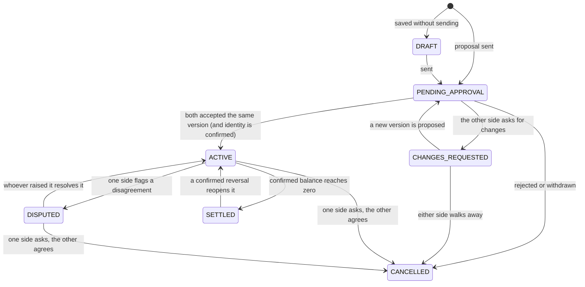
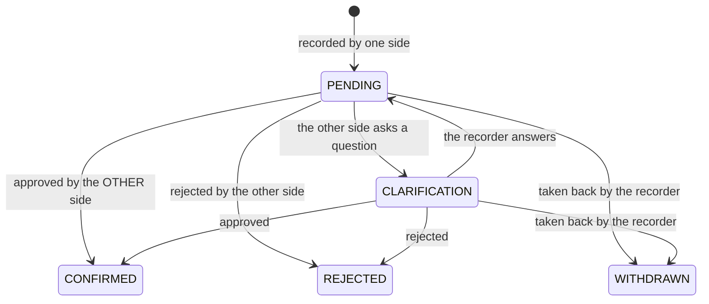

# Architecture

*[Versión en español](../es/ARCHITECTURE.md)*

Symmetry Debt is one Next.js application backed by PostgreSQL. This document explains how it is
put together and, above all, how it keeps its central promise:

> **What one person wrote down and what two people agreed on are never confused.**

## Contents

1. [The two modes](#1-the-two-modes)
2. [Layers](#2-layers)
3. [Data model](#3-data-model)
4. [Life cycles](#4-life-cycles)
5. [From a personal record to a shared agreement](#5-from-a-personal-record-to-a-shared-agreement)
6. [Share links and who is on the other side](#6-share-links-and-who-is-on-the-other-side)
7. [Money and dates](#7-money-and-dates)
8. [Balances and schedules](#8-balances-and-schedules)
9. [Concurrency and idempotency](#9-concurrency-and-idempotency)
10. [What the database itself refuses](#10-what-the-database-itself-refuses)
11. [Audit trail](#11-audit-trail)
12. [Notifications and reminders](#12-notifications-and-reminders)
13. [Receipts](#13-receipts)
14. [Sign-in and sessions](#14-sign-in-and-sessions)
15. [Languages](#15-languages)
16. [Base path](#16-base-path)

---

## 1. The two modes

Every debt is managed in exactly one mode, chosen when it is created and never changed.

| | `PERSONAL` — personal tracking | `SHARED` — shared agreement |
|---|---|---|
| Belongs to | one user (`Debt.ownerId`) | its two participants (`DebtParticipant`) |
| The other person | a private contact; needs no account | a registered user who joined through a link |
| Terms | edited freely by the owner | immutable versions; in force only when **both** accepted the same one |
| A payment | a `PERSONAL_RECORD`; counts at once; editable | starts `PENDING`; counts only when the **other** side approves (`CONFIRMED`) |
| Balance shown | *recorded* balance | *confirmed* balance (pending amounts are shown apart) |
| Corrections | edit or delete | a reversal or an adjustment that both sides approve |
| Who can see it | only the owner | only the two participants |

The mode is not a flag that code is trusted to respect: rows of one mode cannot hold the states
of the other (see [section 10](#10-what-the-database-itself-refuses)).

## 2. Layers

```
src/domain      pure functions, no I/O — the rules
src/schemas     Zod schemas for everything that comes from outside
src/server      I/O: database, session, crypto, mail, storage, audit, notifications
  └ services    the use cases; the only code that changes data
src/actions     server actions: resolve the signed-in person, call a service, map errors
src/app         pages (server components) and route handlers
src/components  interface
```

Rules that hold across the code base:

- **`src/domain` knows nothing about the outside.** Money, dates, CLABE validation, schedules,
  balances, terms and life cycles are pure and unit-tested. The same functions run in the
  browser (to preview) and on the server (to decide).
- **Services receive an explicit `Actor`** (`src/server/actor.ts`) and enforce authorisation
  themselves. Pages and actions never decide who may do what; they ask the service.
- **One authorisation rule for debts**, `requireDebtAccess` (`services/shared.ts`): a personal
  record is visible to its owner only; a shared agreement to its two participants only.
  Everybody else gets "not found" — the existence of a record is not revealed.
- **Read models are computed per viewer** (`services/views.ts`, `services/overview.ts`): which
  side they are on, what is waiting for them and what they may do (`DebtView.can`). The
  interface renders that; it does not work permissions out.
- **Errors a person can act on are `AppError`s** with a code that is a translation key
  (`src/server/errors.ts`). Anything else is a bug: logged, shown as a generic message.

## 3. Data model

Defined in [`prisma/schema.prisma`](../../prisma/schema.prisma). Every entity and why it exists:

### Identity

| Entity | Purpose |
|---|---|
| `User` | A person, identified internally by an id — never by their email. |
| `Account` | The Google identity (`provider` + `providerAccountId`). Provider tokens are **not** stored. |
| `Session` | Server-side session. `sessionToken` holds a SHA-256 hash, not the cookie value. |
| `UserPreferences` | Language, time zone, default currency, which reminders and emails the person wants. |

### People

| Entity | Purpose |
|---|---|
| `Contact` | A counterparty **as seen by one user**: a private address-book entry. `linkedUserId` is set only when that person joined an agreement through an invitation — never by matching a name or an email. |

### Debts

| Entity | Purpose |
|---|---|
| `Debt` | The debt itself: mode, status and the terms in force. Personal records carry `ownerId`, `ownerRole`, `contactId`, private notes. Shared agreements carry `currentVersionId` and, when they came from a personal record, `sourceDebtId`. |
| `DebtParticipant` | The two sides of a shared agreement, one row per role (`DEBTOR`, `CREDITOR`). `userId` is empty until somebody joins; `identityConfirmedAt` records that the proposer recognised them. |
| `DebtVersion` | An immutable snapshot of terms proposed by one side (`terms` JSON + `termsHash`). |
| `DebtApproval` | One side's answer to one version: accepted, rejected or changes requested — with the hash they were looking at. |
| `Installment` | The schedule in force. Replaced as a whole when the schedule changes. |

### Movements

| Entity | Purpose |
|---|---|
| `Payment` | A movement: `PAYMENT`, `ADJUSTMENT_INCREASE`, `ADJUSTMENT_DECREASE` or `REVERSAL`. Keeps the date the money moved (`effectiveDate`) apart from when it was written down (`recordedAt`). |
| `PaymentApproval` | Append-only log of what each side said about a movement. |
| `PaymentBankDetails` | Extra data for transfers and deposits: origin bank, destination (a masked label), tracking key. |

The payment *method* (cash, transfer, deposit, card as a manual record, other) is an enum,
`PaymentMethodType`. The debt has a planned method; each payment records the one actually used.

### Bank accounts

| Entity | Purpose |
|---|---|
| `BankAccount` | An account where a user can **receive** money. CLABE and account number are encrypted; only the last four digits are stored in clear, for display. There is no column for passwords, PINs or card data. |
| `BankAccountShare` | The owner's explicit permission to show one account's details to the other participant of **one** agreement. Revocable. |

### Everything else

| Entity | Purpose |
|---|---|
| `Attachment` | A receipt. The file lives in private storage under an unguessable key. |
| `Invitation` | A share link for the other side of an agreement (only a hash of its token is stored). |
| `Notification` | An in-app notification: a type plus data, rendered in the reader's language when read. |
| `AuditEvent` | The history. Append-only. |
| `RateLimitBucket` | Counters for rate limiting that work across several app instances. |

## 4. Life cycles

Implemented as pure functions in [`src/domain/lifecycle.ts`](../../src/domain/lifecycle.ts).

### Debts

A **personal record** is `ACTIVE`, `SETTLED` (the balance reached zero; automatic, and it goes
back to `ACTIVE` if a payment is removed), `CANCELLED` (by its owner; can be reopened) or
`CONVERTED` (a shared agreement proposed from it came into force; read-only archive).

A **shared agreement**:



A disputed agreement does not settle by itself; the balance is re-evaluated when the dispute is
resolved.

### Versions of the terms

`DRAFT → PROPOSED → ACCEPTED | REJECTED | CHANGES_REQUESTED | WITHDRAWN | SUPERSEDED`, and
`ACCEPTED → SUPERSEDED` when a later version replaces it.

- Proposing terms **is** accepting them: the proposer's `DebtApproval` is written with the
  version. The other side accepts, rejects or asks for changes. Nobody can accept their own
  proposal.
- Every answer carries the `termsHash` the person had on screen. If the terms on the table
  changed in the meantime the answer is refused (`stale`), so both sides always accept *the same*
  version.
- Before the agreement is in force (`INITIAL` versions) anything can be renegotiated. Once it is
  in force a new version is an `AMENDMENT`: it may change the concept, the schedule, the planned
  method and the notes, but **not the amount** — amounts change through adjustments that both
  sides approve. The previous version keeps governing until the amendment is accepted.
- The single place where anything becomes "agreed" is `finalizeIfReady`
  (`services/agreement-core.ts`).

### Movements in a shared agreement



Whoever recorded a movement can never confirm it; this holds whether the debtor recorded a
payment or the creditor recorded having received one. Only `CONFIRMED` rows change the confirmed
balance, and a confirmed row is immutable. A mistake is corrected with a `REVERSAL` (always for
the full amount of the payment it undoes) or an adjustment — each of which is itself a movement
that the other side must approve.

In a personal record every movement is a `PERSONAL_RECORD`: it counts at once and its owner can
edit or delete it, leaving a trace in the record's private history.

## 5. From a personal record to a shared agreement

`services/conversion.ts`. Converting **never modifies the personal record**:

1. The owner picks what to share: the whole amount plus the payments they select, or only the
   balance owed today (no history at all). Private notes and receipts are copied only if asked.
2. A **new** shared agreement is created in `PENDING_APPROVAL`, pointing back at the record
   (`sourceDebtId`). The selected payments are not copied as payments: they are listed inside
   the proposed terms as *earlier payments to be recognised*.
3. The other person opens the share link and answers.
4. Only when both have accepted that version do those payments become `CONFIRMED` rows
   (`origin = HISTORICAL`) — confirmed because both accepted the version that lists them, not
   because one side had written them down. The personal record becomes `CONVERTED`: a read-only
   archive with its whole history intact, including whatever was not shared.
5. If the proposal is rejected or withdrawn, the personal record is exactly as it was and stays
   fully usable.

The other person never gains access to the personal record itself, and a unique partial index
allows a record to back at most one live proposal.

## 6. Share links and who is on the other side

`services/invitations.ts`, `services/agreement-core.ts`.

Every proposal produces a **share link** the proposer can send any way they like. The link
contains a 256-bit random token; only its SHA-256 hash is stored. It is single-use, expires
(`INVITATION_TTL_DAYS`, 14 by default), and can be revoked and regenerated.

The proposer may also say which email address the link is meant for. That decides how the
person who opens it is treated:

| Situation | What happens when they accept |
|---|---|
| The invitation names an address **and** it is their Google-verified address | They are who the proposer meant: the agreement comes into force. |
| The invitation names no address, or they signed in with a different account | Their acceptance is recorded, but the agreement only comes into force after the **proposer confirms** that whoever joined is the right person. |

Until then the newcomer cannot record movements, attach files or see shared bank details. If it
is the wrong person, the proposer removes them: their answer is discarded with the version it
was given to (a new, identical version is issued), a fresh link is made, and nobody who joins
later learns who that was.

Other rules:

- Only accounts whose email **Google has verified** can sign in at all.
- An email address alone opens nothing. Typing somebody's address does not reveal whether they
  have an account, and never links a contact to them.
- When the invitation names the verified address of an existing user, it also shows up inside
  their account. They still have to open it and decide.
- Somebody who **declines** is never attached to the agreement and keeps no trace of it.
- The invitation email (when email is configured) says nothing about the debt: no concept, no
  amounts. Details are shown after signing in.
- A contact that is already linked through an earlier agreement receives new proposals directly,
  without a new link.

## 7. Money and dates

- **Amounts are `bigint` minor units** (cents) everywhere — `BIGINT` in PostgreSQL. Text typed by
  a person is parsed with string arithmetic (`parseAmount`); amounts are formatted by handing
  `Intl.NumberFormat` an exact decimal string. No float ever touches an amount.
- The parser refuses to guess: `1,500` is one thousand five hundred, `1500,5` has a decimal
  comma, but `1.500` in a currency with cents is rejected rather than interpreted.
- Amounts in different currencies are never added together; totals are per currency.
- **Due dates and payment dates are calendar dates**, carried as `YYYY-MM-DD` strings and stored
  in `DATE` columns, so "March 5th" is March 5th in every time zone. "Today" is computed in each
  user's own time zone.

## 8. Balances and schedules

- **A balance is never stored.** It is recomputed from the movements every time
  (`computeBalance`, `src/domain/balance.ts`): amount + increases − decreases − payments +
  reversals, counting only the rows that carry weight in that mode.
- In a shared agreement, movements waiting for the other side are reported separately
  (`pendingPaymentsMinor`…) and never subtracted. They *are* taken into account when checking
  whether a new payment would overshoot, so two pending payments cannot add up to more than
  what is owed; the check runs again at the moment of confirming.
- **Payments are not tied to an instalment.** Whatever has been paid is poured over the schedule
  in due-date order (`allocatePayments`, `src/domain/schedule.ts`), which makes early payments,
  partial payments, edits and reversals behave consistently. A reduction of the debt comes off
  the last instalments; an increase shows up as "unscheduled" until the plan is rewritten.
- The dashboard keeps four figures apart, per currency and per direction: *recorded* (personal),
  *confirmed* (shared), *awaiting confirmation* and *proposed*. The net balance only uses the
  first two.

## 9. Concurrency and idempotency

- **One row lock per debt.** Every service that changes a debt opens a transaction, takes
  `SELECT … FOR UPDATE` on the debt row (`lockDebt`) and only then reads the state it is about to
  change. Two approvals, two payments or two proposals racing each other are serialised.
- **Optimistic counter.** `Debt.lockVersion` is bumped on every state change.
- **Idempotency keys.** Forms generate a UUID when they open. Creating a debt, recording a
  movement and proposing a version store that key under a unique constraint, so a double click,
  a retry or a replayed request returns the first result instead of creating a second row.
  Decisions (approve, reject…) are idempotent by state: repeating one that already took effect
  does nothing.
- **Reminders** carry a de-duplication key, so the job can run from several instances and from
  an external scheduler at the same time.

All of this is exercised in `tests/integration` with truly concurrent calls.

## 10. What the database itself refuses

The application enforces every rule. The database enforces the most important ones again, so a
bug or a hand-written query cannot leave the data in a state that mixes up the two modes. They
live in [`prisma/migrations/20261116000100_integrity_rules`](../../prisma/migrations/20261116000100_integrity_rules/migration.sql).

**Triggers** (the code appears in the error message):

| Code | Rule |
|---|---|
| `SD001` | The mode of a debt cannot change. |
| `SD002` | A personal record cannot hold a bilateral movement. |
| `SD003` | A shared agreement cannot hold a personal record. |
| `SD004` | A confirmed movement cannot be changed or deleted. |
| `SD005` | A version that was proposed cannot be deleted. |
| `SD006` | The terms of a proposed version cannot be changed. |
| `SD007` | An accepted version can only be superseded. |
| `SD008` | A closed version cannot be reopened. |
| `SD009` | `AuditEvent`, `DebtApproval` and `PaymentApproval` are append-only. |

The immutability triggers let through changes that come from a parent row (the whole debt or the
whole account being removed) and block statements aimed at the rows themselves.

**`CHECK` constraints:** amounts are positive; currency codes are three capital letters; a
personal record has an owner, a role and a contact and none of the bilateral machinery, while a
shared agreement has no owner; each mode only admits its own statuses; a reversal points at the
payment it undoes; a recognised earlier payment is a confirmed payment tied to a version;
`confirmedAt` is set exactly when the status is `CONFIRMED`.

**Partial unique indexes:** one live proposal per personal record; one open proposal per
agreement; one live reversal per payment; one pending invitation per agreement; one preferred
bank account per user.

## 11. Audit trail

Every meaningful change writes one `AuditEvent` **in the same transaction** as the change
(`src/server/audit.ts`). The timeline of a debt is its events in order, plus computed entries for
instalments that became overdue.

- Scope: `PERSONAL` (only the owner reads it), `SHARED` (both participants) or `ACCOUNT` (the
  user's own account: bank accounts, exports, sessions).
- Some shared events are for one side only (who a link was meant for, who was turned away).
  Things done by somebody who is no longer on the agreement are shown only to the side that
  dealt with them.
- Each entry carries a weight for the interface: *personal*, *one side*, *both sides*.

## 12. Notifications and reminders

- A notification is a type plus data (`src/lib/notification-types.ts`). It is rendered in the
  **reader's** language at the moment it is read, so changing language also translates the old
  ones. Emails are written in the recipient's language.
- Categories: `ACTION_REQUIRED` (somebody is waiting for you, or something was refused — always
  shown in the app), `ACTIVITY`, `REMINDER` (due dates; can be switched off).
- Email is optional (`EMAIL_PROVIDER=none|smtp|resend`). Whether a notification also goes out by
  email is decided from the recipient's preferences when it is created; sending happens after
  the transaction, from an outbox that several instances can drain safely.
- **Reminders** (`services/reminders.ts`): for each instalment with something pending — three
  days before, on the day, and once overdue. A personal record reminds only its owner; a shared
  agreement reminds both participants, each with their own wording. The job runs on a timer
  inside the server (`src/instrumentation.ts`, hourly) and can also be triggered by an external
  scheduler through `POST <base path>/api/cron/reminders`.

## 13. Receipts

`services/attachments.ts`, `src/server/storage/`.

- PDF, JPG, PNG and WebP. A file is identified by its **first bytes**; the name and the type
  announced by the browser are ignored. Size limit: `MAX_UPLOAD_MB`.
- Storage is private: a local directory or any S3-compatible bucket (`STORAGE_DRIVER`). Keys are
  random; the original name lives only in the database. Files are served exclusively through
  `<base path>/api/attachments/<id>`, after checking who is asking.
- A receipt is evidence somebody attached. **It never confirms a payment.**
- In a shared agreement only the uploader can remove a receipt, and never once the movement it
  supports is confirmed.

## 14. Sign-in and sessions

`src/server/auth/`. Auth.js (next-auth v5) with Google as the only provider and sessions stored
in the database. On top of the stock Prisma adapter:

- session tokens are stored **hashed**;
- provider tokens (access, refresh, id) are **not stored**;
- emails are normalised to lower case, and only Google-verified addresses may sign in;
- the OAuth callback always starts from a clean slate, so signing in on a shared computer never
  attaches a Google identity to somebody else's open session;
- a user row nobody has ever proven they own — created by an import script, or carrying only
  identities from the local mock issuer — is adopted by the first verified sign-in with that
  address. A row that already has a real Google identity is never claimable.

Cookies are `HttpOnly`, `SameSite=Lax`, `Secure` on HTTPS and scoped to the base path, so the
session never travels to other applications on the same domain. Pages also carry a strict
Content-Security-Policy with a per-request nonce (`src/proxy.ts`).

More in [SECURITY_MODEL.md](SECURITY_MODEL.md) and [DATA_AND_PRIVACY.md](DATA_AND_PRIVACY.md).

## 15. Languages

Spanish is the default and English the second language (`next-intl`). There is no `/es` or `/en`
in the address: a signed-in user gets the language saved in their preferences, anybody else the
one remembered in a cookie, and otherwise Spanish. The browser's language is never applied
automatically; it is only used to *offer* a switch.

All texts live in `messages/es.json` and `messages/en.json`. Keys are type-checked against the
Spanish catalogue, and validation and business errors are keys too.

## 16. Base path

The app can live under a path of a domain (`/debt` on the official instance) or at its root.
`NEXT_PUBLIC_BASE_PATH` is read when the app is **built**. Three things must agree with it and
are all derived from it and from `APP_URL`: the path of the auth endpoints, the redirect URI
registered with Google, and the path the cookies are scoped to.

See [SELF_HOSTING.md](SELF_HOSTING.md) and [DEPLOY_RAILWAY.md](DEPLOY_RAILWAY.md).
