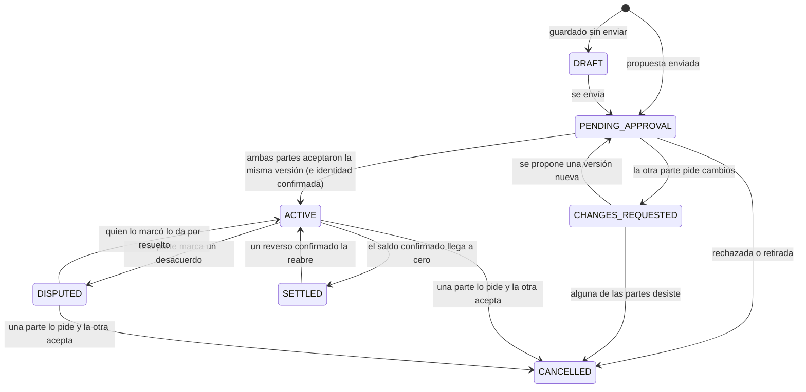
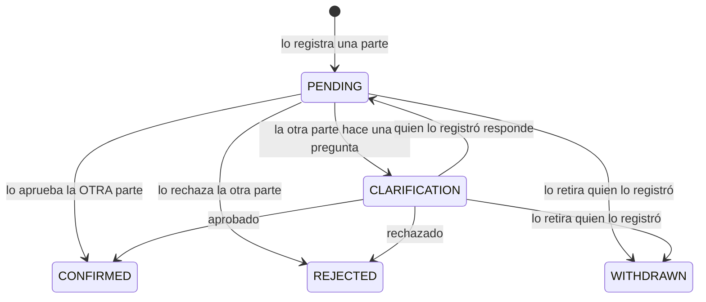

# Arquitectura

*[English version](../en/ARCHITECTURE.md)*

Symmetry Debt es una sola aplicación Next.js sobre PostgreSQL. Este documento explica cómo está
construida y, sobre todo, cómo cumple su promesa central:

> **Lo que una persona anotó y lo que dos personas acordaron nunca se confunden.**

## Contenido

1. [Las dos modalidades](#1-las-dos-modalidades)
2. [Capas](#2-capas)
3. [Modelo de datos](#3-modelo-de-datos)
4. [Ciclos de vida](#4-ciclos-de-vida)
5. [De un registro personal a un acuerdo compartido](#5-de-un-registro-personal-a-un-acuerdo-compartido)
6. [Enlaces para compartir y quién está del otro lado](#6-enlaces-para-compartir-y-quién-está-del-otro-lado)
7. [Dinero y fechas](#7-dinero-y-fechas)
8. [Saldos y calendarios](#8-saldos-y-calendarios)
9. [Concurrencia e idempotencia](#9-concurrencia-e-idempotencia)
10. [Lo que la propia base de datos rechaza](#10-lo-que-la-propia-base-de-datos-rechaza)
11. [Auditoría](#11-auditoría)
12. [Notificaciones y recordatorios](#12-notificaciones-y-recordatorios)
13. [Comprobantes](#13-comprobantes)
14. [Inicio de sesión y sesiones](#14-inicio-de-sesión-y-sesiones)
15. [Idiomas](#15-idiomas)
16. [Ruta base](#16-ruta-base)

---

## 1. Las dos modalidades

Cada deuda se gestiona en exactamente una modalidad, que se elige al crearla y no cambia nunca.

| | `PERSONAL` — seguimiento personal | `SHARED` — acuerdo compartido |
|---|---|---|
| Pertenece a | una persona (`Debt.ownerId`) | sus dos participantes (`DebtParticipant`) |
| La otra persona | un contacto privado; no necesita cuenta | un usuario registrado que se unió con un enlace |
| Condiciones | su titular las edita con libertad | versiones inmutables; rigen solo cuando **ambas partes** aceptaron la misma |
| Un pago | es un `PERSONAL_RECORD`; cuenta de inmediato; se puede editar | empieza `PENDING`; cuenta solo cuando la **otra** parte lo aprueba (`CONFIRMED`) |
| Saldo que se muestra | saldo *registrado* | saldo *confirmado* (lo pendiente se muestra aparte) |
| Correcciones | editar o borrar | un reverso o un ajuste que ambas partes aprueban |
| Quién puede verla | solo su titular | solo las dos partes |

La modalidad no es una marca que el código promete respetar: las filas de una modalidad no
pueden contener los estados de la otra (ver la [sección 10](#10-lo-que-la-propia-base-de-datos-rechaza)).

## 2. Capas

```
src/domain      funciones puras, sin E/S — las reglas
src/schemas     esquemas Zod para todo lo que llega de fuera
src/server      E/S: base de datos, sesión, cifrado, correo, archivos, auditoría, notificaciones
  └ services    los casos de uso; el único código que modifica datos
src/actions     server actions: resuelven quién tiene la sesión, llaman a un servicio, traducen errores
src/app         páginas (componentes de servidor) y rutas
src/components  interfaz
```

Reglas que valen en todo el código:

- **`src/domain` no sabe nada del exterior.** Dinero, fechas, validación de CLABE, calendarios,
  saldos, condiciones y ciclos de vida son funciones puras con pruebas unitarias. Las mismas
  funciones corren en el navegador (para previsualizar) y en el servidor (para decidir).
- **Los servicios reciben de forma explícita a quien actúa** (`Actor`, en `src/server/actor.ts`)
  y aplican ellos mismos la autorización. Las páginas y las acciones nunca deciden quién puede
  hacer qué: se lo preguntan al servicio.
- **Una sola regla de acceso a las deudas**, `requireDebtAccess` (`services/shared.ts`): un
  registro personal solo lo ve su titular; un acuerdo compartido, solo sus dos participantes. A
  cualquier otra persona se le responde «no encontrado»: no se revela que el registro existe.
- **Los modelos de lectura se calculan para quien mira** (`services/views.ts`,
  `services/overview.ts`): de qué lado está, qué le espera y qué puede hacer (`DebtView.can`).
  La interfaz lo pinta; no deduce permisos.
- **Los errores ante los que una persona puede hacer algo son `AppError`**, con un código que
  es una clave de traducción (`src/server/errors.ts`). Cualquier otra cosa es un fallo: se
  registra y se muestra un mensaje genérico.

## 3. Modelo de datos

Definido en [`prisma/schema.prisma`](../../prisma/schema.prisma). Cada entidad y para qué existe:

### Identidad

| Entidad | Para qué |
|---|---|
| `User` | Una persona, identificada internamente por un id — nunca por su correo. |
| `Account` | La identidad de Google (`provider` + `providerAccountId`). Los tokens del proveedor **no** se guardan. |
| `Session` | Sesión del lado del servidor. `sessionToken` contiene un hash SHA-256, no el valor de la cookie. |
| `UserPreferences` | Idioma, zona horaria, moneda predeterminada, qué recordatorios y correos quiere la persona. |

### Personas

| Entidad | Para qué |
|---|---|
| `Contact` | Una contraparte **vista por un usuario**: una entrada privada de su agenda. `linkedUserId` solo se llena cuando esa persona se unió a un acuerdo mediante una invitación — nunca por coincidir un nombre o un correo. |

### Deudas

| Entidad | Para qué |
|---|---|
| `Debt` | La deuda: modalidad, estado y condiciones vigentes. Los registros personales llevan `ownerId`, `ownerRole`, `contactId` y notas privadas. Los acuerdos compartidos llevan `currentVersionId` y, si nacieron de un registro personal, `sourceDebtId`. |
| `DebtParticipant` | Las dos partes de un acuerdo compartido, una fila por rol (`DEBTOR`, `CREDITOR`). `userId` está vacío hasta que alguien se une; `identityConfirmedAt` registra que quien propuso reconoció a esa persona. |
| `DebtVersion` | Una instantánea inmutable de las condiciones propuestas por una parte (`terms` en JSON + `termsHash`). |
| `DebtApproval` | La respuesta de una parte a una versión: aceptada, rechazada o con cambios solicitados — con el hash que tenía delante. |
| `Installment` | El calendario vigente. Se reemplaza completo cuando cambia. |

### Movimientos

| Entidad | Para qué |
|---|---|
| `Payment` | Un movimiento: `PAYMENT`, `ADJUSTMENT_INCREASE`, `ADJUSTMENT_DECREASE` o `REVERSAL`. Guarda por separado la fecha en que se movió el dinero (`effectiveDate`) y el momento en que se anotó (`recordedAt`). |
| `PaymentApproval` | Bitácora, solo de adición, de lo que cada parte dijo sobre un movimiento. |
| `PaymentBankDetails` | Datos extra de transferencias y depósitos: banco de origen, destino (una etiqueta enmascarada), clave de rastreo. |

El *método* de pago (efectivo, transferencia, depósito, tarjeta como registro manual, otro) es
un enumerado, `PaymentMethodType`. La deuda tiene un método previsto; cada pago registra el que
se usó en realidad.

### Cuentas bancarias

| Entidad | Para qué |
|---|---|
| `BankAccount` | Una cuenta donde un usuario puede **recibir** dinero. La CLABE y el número de cuenta están cifrados; en claro solo se guardan los últimos cuatro dígitos, para mostrarlos. No existe ninguna columna para contraseñas, NIP ni datos de tarjeta. |
| `BankAccountShare` | El permiso explícito de la persona titular para mostrar los datos de una cuenta a la otra parte de **un** acuerdo. Revocable. |

### Lo demás

| Entidad | Para qué |
|---|---|
| `Attachment` | Un comprobante. El archivo vive en almacenamiento privado bajo una clave imposible de adivinar. |
| `Invitation` | Un enlace para compartir con la otra parte de un acuerdo (solo se guarda un hash de su token). |
| `Notification` | Una notificación dentro de la app: un tipo más datos, redactada en el idioma de quien la lee, al leerla. |
| `AuditEvent` | El historial. Solo de adición. |
| `RateLimitBucket` | Contadores para limitar el ritmo de uso, válidos entre varias instancias de la app. |

## 4. Ciclos de vida

Implementados como funciones puras en [`src/domain/lifecycle.ts`](../../src/domain/lifecycle.ts).

### Deudas

Un **registro personal** está `ACTIVE`, `SETTLED` (el saldo llegó a cero; es automático, y vuelve
a `ACTIVE` si se quita un pago), `CANCELLED` (por su titular; se puede reabrir) o `CONVERTED` (un
acuerdo compartido propuesto a partir de él entró en vigor; queda como archivo de solo lectura).

Un **acuerdo compartido**:



Un acuerdo en disputa no se liquida solo; el saldo se vuelve a evaluar cuando la disputa se
resuelve.

### Versiones de las condiciones

`DRAFT → PROPOSED → ACCEPTED | REJECTED | CHANGES_REQUESTED | WITHDRAWN | SUPERSEDED`, y
`ACCEPTED → SUPERSEDED` cuando una versión posterior la reemplaza.

- Proponer condiciones **es** aceptarlas: la `DebtApproval` de quien propone se escribe junto con
  la versión. La otra parte acepta, rechaza o pide cambios. Nadie puede aceptar su propia
  propuesta.
- Cada respuesta lleva el `termsHash` que la persona tenía en pantalla. Si las condiciones sobre
  la mesa cambiaron mientras tanto, la respuesta se rechaza (`stale`): así ambas partes aceptan
  siempre *la misma* versión.
- Antes de que el acuerdo esté en vigor (versiones `INITIAL`) todo se puede renegociar. Una vez
  en vigor, una versión nueva es una `AMENDMENT`: puede cambiar el concepto, el calendario, el
  método previsto y las notas, pero **no el importe** — los importes cambian mediante ajustes
  que ambas partes aprueban. La versión anterior sigue rigiendo hasta que la enmienda se acepta.
- El único lugar donde algo pasa a estar «acordado» es `finalizeIfReady`
  (`services/agreement-core.ts`).

### Movimientos en un acuerdo compartido



Quien registró un movimiento nunca puede confirmarlo; vale igual si el deudor registró un pago o
si el acreedor registró haberlo recibido. Solo las filas `CONFIRMED` cambian el saldo
confirmado, y una fila confirmada es inmutable. Un error se corrige con un `REVERSAL` (siempre
por el importe completo del pago que deshace) o con un ajuste — y cada uno es a su vez un
movimiento que la otra parte debe aprobar.

En un registro personal todo movimiento es un `PERSONAL_RECORD`: cuenta de inmediato y su titular
puede editarlo o borrarlo, dejando rastro en el historial privado del registro.

## 5. De un registro personal a un acuerdo compartido

`services/conversion.ts`. Convertir **nunca modifica el registro personal**:

1. La persona titular elige qué compartir: el importe completo más los pagos que seleccione, o solo el
   saldo que se debe hoy (sin historial). Las notas privadas y los comprobantes solo se copian
   si lo pide.
2. Se crea un acuerdo compartido **nuevo** en `PENDING_APPROVAL`, que apunta al registro
   (`sourceDebtId`). Los pagos seleccionados no se copian como pagos: se listan dentro de las
   condiciones propuestas como *abonos previos por reconocer*.
3. La otra persona abre el enlace y responde.
4. Solo cuando ambas aceptaron esa versión esos abonos se convierten en filas `CONFIRMED`
   (`origin = HISTORICAL`) — confirmados porque ambas aceptaron la versión que los lista, no
   porque una parte los tuviera anotados. El registro personal pasa a `CONVERTED`: un archivo
   de solo lectura con todo su historial intacto, incluido lo que no se compartió.
5. Si la propuesta se rechaza o se retira, el registro personal queda exactamente como estaba y
   sigue siendo plenamente utilizable.

La otra persona nunca obtiene acceso al registro personal, y un índice único parcial impide que
un registro respalde más de una propuesta viva.

## 6. Enlaces para compartir y quién está del otro lado

`services/invitations.ts`, `services/agreement-core.ts`.

Toda propuesta genera un **enlace para compartir** que quien propone puede enviar por donde
quiera. El enlace contiene un token aleatorio de 256 bits; solo se guarda su hash SHA-256. Es de
un solo uso, vence (`INVITATION_TTL_DAYS`, 14 por omisión) y se puede revocar y regenerar.

Quien propone puede indicar además a qué correo va dirigido el enlace. Eso decide cómo se trata a
la persona que lo abre:

| Situación | Qué pasa cuando acepta |
|---|---|
| La invitación nombra un correo **y** es su correo verificado por Google | Es la persona que se quiso invitar: el acuerdo entra en vigor. |
| La invitación no nombra ningún correo, o la persona entró con otra cuenta | Su aceptación queda registrada, pero el acuerdo solo entra en vigor cuando **quien propuso confirma** que quien se unió es la persona correcta. |

Hasta entonces, la persona recién llegada no puede registrar movimientos, adjuntar archivos ni
ver datos bancarios compartidos. Si no es la persona correcta, quien propuso la retira: su
respuesta se descarta junto con la versión a la que respondió (se emite una versión nueva,
idéntica), se genera otro enlace, y nadie que se una después sabrá quién fue.

Otras reglas:

- Solo pueden iniciar sesión las cuentas cuyo correo **verificó Google**.
- Un correo, por sí solo, no abre nada. Escribir el correo de alguien no revela si tiene cuenta
  ni vincula un contacto con esa persona.
- Cuando la invitación nombra el correo verificado de un usuario existente, también aparece
  dentro de su cuenta. Aun así tiene que abrirla y decidir.
- Quien **rechaza** nunca queda asociado al acuerdo ni conserva rastro de él.
- El correo de invitación (si el correo está configurado) no dice nada sobre la deuda: ni
  concepto ni importes. Los detalles se muestran después de iniciar sesión.
- Un contacto ya vinculado por un acuerdo anterior recibe las propuestas nuevas directamente,
  sin enlace.

## 7. Dinero y fechas

- **Los importes son `bigint` en la unidad mínima** (centavos) en todas partes — `BIGINT` en
  PostgreSQL. Lo que escribe una persona se interpreta con aritmética de cadenas
  (`parseAmount`); los importes se muestran entregando a `Intl.NumberFormat` una cadena decimal
  exacta. Ningún número de punto flotante toca un importe.
- El analizador se niega a adivinar: `1,500` es mil quinientos, `1500,5` lleva coma decimal,
  pero `1.500` en una moneda con centavos se rechaza en lugar de interpretarse.
- Nunca se suman importes de monedas distintas; los totales son por moneda.
- **Los vencimientos y las fechas de pago son fechas de calendario**: viajan como `AAAA-MM-DD` y
  se guardan en columnas `DATE`, de modo que «5 de marzo» es 5 de marzo en cualquier zona
  horaria. «Hoy» se calcula en la zona horaria de cada usuario.

## 8. Saldos y calendarios

- **Un saldo nunca se guarda.** Se recalcula cada vez a partir de los movimientos
  (`computeBalance`, `src/domain/balance.ts`): importe + aumentos − reducciones − pagos +
  reversos, contando solo las filas que tienen peso en esa modalidad.
- En un acuerdo compartido, los movimientos que esperan a la otra parte se informan por separado
  (`pendingPaymentsMinor`…) y nunca se restan. *Sí* se tienen en cuenta al comprobar si un pago
  nuevo se pasaría, para que dos pagos pendientes no sumen más de lo que se debe; la
  comprobación se repite en el momento de confirmar.
- **Los pagos no están atados a una cuota.** Lo pagado se reparte sobre el calendario en orden
  de vencimiento (`allocatePayments`, `src/domain/schedule.ts`); así los pagos anticipados, los
  parciales, las ediciones y los reversos se comportan de forma coherente. Una reducción de la
  deuda se descuenta de las últimas cuotas; un aumento aparece como «sin programar» hasta que se
  reescribe el plan.
- El panel mantiene separadas cuatro cifras, por moneda y por sentido: *registrado* (personal),
  *confirmado* (compartido), *por confirmar* y *propuesto*. El saldo neto solo usa las dos
  primeras.

## 9. Concurrencia e idempotencia

- **Un bloqueo de fila por deuda.** Todo servicio que modifica una deuda abre una transacción,
  toma `SELECT … FOR UPDATE` sobre la fila de la deuda (`lockDebt`) y solo entonces lee el
  estado que va a cambiar. Dos aprobaciones, dos pagos o dos propuestas que compiten quedan en
  fila.
- **Contador optimista.** `Debt.lockVersion` aumenta en cada cambio de estado.
- **Claves de idempotencia.** Los formularios generan un UUID al abrirse. Crear una deuda,
  registrar un movimiento y proponer una versión guardan esa clave bajo una restricción única,
  de modo que un doble clic, un reintento o una petición repetida devuelven el primer resultado
  en lugar de crear una segunda fila. Las decisiones (aprobar, rechazar…) son idempotentes por
  estado: repetir una que ya surtió efecto no hace nada.
- **Los recordatorios** llevan una clave de deduplicación, así que el trabajo puede ejecutarse
  desde varias instancias y desde un programador externo a la vez.

Todo esto se ejercita en `tests/integration` con llamadas realmente simultáneas.

## 10. Lo que la propia base de datos rechaza

La aplicación aplica todas las reglas. La base de datos vuelve a aplicar las más importantes,
para que un fallo o una consulta escrita a mano no puedan dejar los datos en un estado que
mezcle las dos modalidades. Están en
[`prisma/migrations/20261116000100_integrity_rules`](../../prisma/migrations/20261116000100_integrity_rules/migration.sql).

**Disparadores** (el código aparece en el mensaje de error):

| Código | Regla |
|---|---|
| `SD001` | La modalidad de una deuda no puede cambiar. |
| `SD002` | Un registro personal no puede contener un movimiento bilateral. |
| `SD003` | Un acuerdo compartido no puede contener un registro personal. |
| `SD004` | Un movimiento confirmado no puede modificarse ni borrarse. |
| `SD005` | Una versión que ya se propuso no puede borrarse. |
| `SD006` | Las condiciones de una versión propuesta no pueden modificarse. |
| `SD007` | Una versión aceptada solo puede ser reemplazada. |
| `SD008` | Una versión cerrada no puede reabrirse. |
| `SD009` | `AuditEvent`, `DebtApproval` y `PaymentApproval` son solo de adición. |

Los disparadores de inmutabilidad dejan pasar los cambios que vienen de una fila padre (se
elimina la deuda entera o la cuenta entera) y bloquean las sentencias dirigidas a las propias
filas.

**Restricciones `CHECK`:** los importes son positivos; los códigos de moneda son tres letras
mayúsculas; un registro personal tiene titular, rol y contacto y nada de la maquinaria bilateral,
mientras que un acuerdo compartido no tiene titular; cada modalidad solo admite sus propios
estados; un reverso apunta al pago que deshace; un abono previo reconocido es un pago confirmado
ligado a una versión; `confirmedAt` está presente exactamente cuando el estado es `CONFIRMED`.

**Índices únicos parciales:** una propuesta viva por registro personal; una propuesta abierta
por acuerdo; un reverso vivo por pago; una invitación pendiente por acuerdo; una cuenta bancaria
preferida por usuario.

## 11. Auditoría

Cada cambio relevante escribe un `AuditEvent` **en la misma transacción** que el cambio
(`src/server/audit.ts`). La línea de tiempo de una deuda son sus eventos en orden, más entradas
calculadas para las cuotas que vencieron.

- Alcance: `PERSONAL` (solo lo lee la persona titular), `SHARED` (ambas partes) o `ACCOUNT` (la propia
  cuenta del usuario: cuentas bancarias, exportaciones, sesiones).
- Algunos eventos compartidos son solo para una parte (a quién iba dirigido un enlace, a quién
  se retiró). Lo que hizo alguien que ya no está en el acuerdo solo se muestra a la parte que
  trató con esa persona.
- Cada entrada lleva un peso para la interfaz: *personal*, *una parte*, *ambas partes*.

## 12. Notificaciones y recordatorios

- Una notificación es un tipo más datos (`src/lib/notification-types.ts`). Se redacta en el
  idioma de **quien la lee** en el momento de leerla, así que cambiar de idioma también traduce
  las antiguas. Los correos se escriben en el idioma de quien los recibe.
- Categorías: `ACTION_REQUIRED` (alguien te espera, o algo fue rechazado — siempre se muestran
  en la app), `ACTIVITY`, `REMINDER` (vencimientos; se pueden desactivar).
- El correo es opcional (`EMAIL_PROVIDER=none|smtp|resend`). Si una notificación también sale
  por correo se decide, según las preferencias de quien la recibe, al crearla; el envío ocurre
  después de la transacción, desde una bandeja de salida que varias instancias pueden vaciar sin
  pisarse.
- **Recordatorios** (`services/reminders.ts`): por cada cuota con algo pendiente — tres días
  antes, el mismo día y una vez vencida. Un registro personal solo avisa a su titular; un acuerdo
  compartido avisa a ambas partes, a cada una con su redacción. El trabajo corre con un
  temporizador dentro del servidor (`src/instrumentation.ts`, cada hora) y también puede
  dispararlo un programador externo con `POST <ruta base>/api/cron/reminders`.

## 13. Comprobantes

`services/attachments.ts`, `src/server/storage/`.

- PDF, JPG, PNG y WebP. Un archivo se identifica por sus **primeros bytes**; el nombre y el tipo
  que anuncia el navegador se ignoran. Límite de tamaño: `MAX_UPLOAD_MB`.
- El almacenamiento es privado: un directorio local o cualquier bucket compatible con S3
  (`STORAGE_DRIVER`). Las claves son aleatorias; el nombre original solo vive en la base de
  datos. Los archivos se sirven únicamente por `<ruta base>/api/attachments/<id>`, después de
  comprobar quién pregunta.
- Un comprobante es una evidencia que alguien adjuntó. **Nunca confirma un pago.**
- En un acuerdo compartido solo quien lo subió puede quitar un comprobante, y nunca una vez
  confirmado el movimiento que respalda.

## 14. Inicio de sesión y sesiones

`src/server/auth/`. Auth.js (next-auth v5) con Google como único proveedor y sesiones guardadas
en la base de datos. Sobre el adaptador estándar de Prisma:

- los tokens de sesión se guardan **con hash**;
- los tokens del proveedor (acceso, refresco, id) **no se guardan**;
- los correos se normalizan a minúsculas, y solo pueden entrar direcciones verificadas por Google;
- el retorno de OAuth siempre parte de cero, de modo que iniciar sesión en una computadora
  compartida nunca añade una identidad de Google a la sesión abierta de otra persona;
- una fila de usuario de la que nadie ha demostrado ser titular — creada por un script de
  importación, o con identidades solo del emisor simulado local — la adopta el primer inicio de
  sesión verificado con ese correo. Una fila que ya tiene una identidad real de Google nunca se
  puede reclamar.

Las cookies son `HttpOnly`, `SameSite=Lax`, `Secure` sobre HTTPS y están limitadas a la ruta
base, así que la sesión nunca viaja a otras aplicaciones del mismo dominio. Las páginas llevan
además una Content-Security-Policy estricta con un nonce por petición (`src/proxy.ts`).

Más en [SECURITY_MODEL.md](SECURITY_MODEL.md) y [DATA_AND_PRIVACY.md](DATA_AND_PRIVACY.md).

## 15. Idiomas

El español es el idioma predeterminado y el inglés el segundo (`next-intl`). No hay `/es` ni
`/en` en la dirección: quien tiene sesión recibe el idioma guardado en sus preferencias;
cualquier otra persona, el recordado en una cookie; y si no, español. El idioma del navegador
nunca se aplica automáticamente: solo se usa para *ofrecer* el cambio.

Todos los textos viven en `messages/es.json` y `messages/en.json`. Las claves se comprueban al
compilar contra el catálogo en español, y los errores de validación y de negocio también son
claves.

## 16. Ruta base

La app puede vivir bajo una ruta de un dominio (`/debt` en la instancia oficial) o en su raíz.
`NEXT_PUBLIC_BASE_PATH` se lee al **compilar** la app. Tres cosas deben coincidir con ella, y
todas se derivan de ella y de `APP_URL`: la ruta de los puntos de autenticación, la URI de
redirección registrada en Google y la ruta a la que se limitan las cookies.

Ver [SELF_HOSTING.md](SELF_HOSTING.md) y [DEPLOY_RAILWAY.md](DEPLOY_RAILWAY.md).
